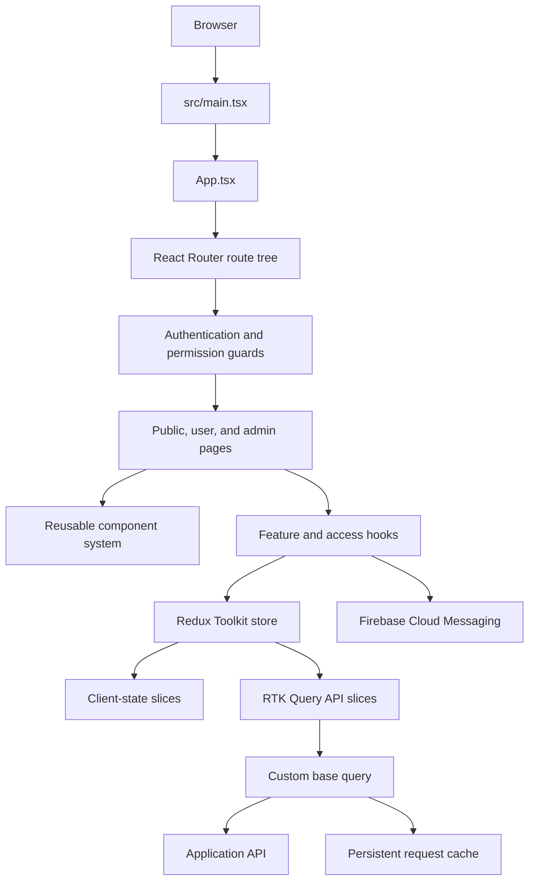

# CU Portal

CU Portal is a production-oriented academic operations platform built with React, TypeScript, Redux Toolkit, RTK Query, Firebase Cloud Messaging, and Vite. It provides distinct public, authenticated student, and permission-gated administrative experiences in one modular single-page application.

The architecture uses explicit domain boundaries, reusable presentation components, typed API contracts, centralized asynchronous data access, and predictable authorization behavior.

## Product Capabilities

- Public landing, team, legal, authentication, and suspended-platform experiences.
- Authenticated student workspace: dashboard, notifications, profile and academic settings, courses, notes, tasks, exams, announcements, events, materials, calendar, timeline, weeks, releases, and other materials.
- Administrative workspace for faculties, departments, years, users, roles, courses, tasks, exams, announcements, events, event organizers, materials, logs, messages, weeks, and releases.
- Reusable list, detail, create, and edit workflows across operational resources.
- Permission-aware routing for administrative capabilities such as `View Users`, `View Courses`, and `View AdminPanel`.
- React Hook Form and Zod validation.
- Firebase Cloud Messaging with service-worker registration, permission management, foreground notifications, and token registration.
- SEO metadata through a shared `PageSeo` component and `react-helmet-async`.
- Google Drive-aware file and material workflows.
- Shared loading, toast, modal, pagination, table, card, calendar, timeline, preview, and layout primitives.

## Architecture At A Glance



## Layered Design

### Presentation Layer

Pages describe product workflows while reusable components encapsulate repeated visual and interaction patterns. CSS Modules and shared CSS variables keep styling local and consistent.

- `components/`: reusable UI primitives and feature components.
- `pages/landing/`: public-facing pages.
- `pages/auth/`: authentication and account onboarding.
- `pages/user/`: authenticated student workflows.
- `pages/admin/`: administrative workflows.
- `assets/`: icons, decorations, snapshots, team imagery, and static resources.

### Application Orchestration Layer

Custom hooks coordinate authentication, user hydration, route messages, notifications, loading, suspension redirects, release dismissal, and access validation without embedding cross-cutting behavior in page components.

- `useAuth.ts`: authentication and route-level access behavior.
- `useGetUser.ts`: session-aware user hydration.
- `useValidateUserLevel.ts`: user-level validation.
- `useAuthQuery.ts`: authenticated query execution with access checks, loading lifecycle, and error handling.
- `usePushNotifications.ts`: notification permission and foreground-notification behavior.
- `useSuspensionRedirect.ts`: platform suspension handling.
- `contexts/`: scoped loading contexts and providers.

### State Management Layer

Redux Toolkit provides a single typed store for client state and RTK Query state, separating durable client concerns from server data concerns.

**Conventional Redux slices:** user/session, notification, process/operation, and release state.

**RTK Query API slices:** authentication, Drive, messages, releases, notifications, and user/admin domains for announcements, calendars, courses, exams, materials, notes, tasks, faculties, departments, years, events, event organizers, weeks, user completion, logs, roles, and users.

Typed Redux hooks in `services/redux/Hooks.ts` expose `RootState` and `AppDispatch`:

```ts
const user = useAppSelector((state) => state.user.user);
const dispatch = useAppDispatch();
```

### Data Access Layer

All API access is modeled through RTK Query endpoints under `services/apis/`. Components consume generated queries and mutations instead of managing ad hoc `fetch` or `axios` calls. This centralizes loading, errors, cache, invalidation, and request lifecycle behavior.

```text
services/apis/
  AuthenticateAPIs.ts  DriveAPIs.ts  MessageAPIs.ts
  user/                 User-facing domain APIs
  admin/                Permission-gated domain APIs
```

### Transport, Reliability, And Caching

`utils/CustomBaseQuery.ts` provides a shared transport policy for RTK Query endpoints:

- `fetchBaseQuery` with up to four retries for network failures and transient `502`/`503` errors.
- Separate read and mutation timeouts.
- In-flight request deduplication using stable request keys.
- Persistent `localStorage` caching for eligible responses.
- Cache keys derived from URL, query parameters, HTTP method, request bodies, and file metadata.
- SHA-256 file/blob fingerprints when serializing upload requests.
- Module-aware invalidation after mutations, including dependent domains such as courses, materials, tasks, exams, announcements, events, notes, calendar, and weeks.
- Explicit bypass rules for non-cacheable authentication endpoints.
- Platform suspension short-circuiting before network activity.
- Google Drive-specific timeout handling.

This gives every feature API a consistent reliability and performance policy while keeping endpoint definitions focused on domain contracts.

### Domain Modeling Layer

The `types/` directory keeps shared contracts separate from UI implementation details:

```text
types/
  dtos/       API request and response transport shapes
  entities/   domain entities
  models/     application-facing models
  props/      reusable component and page props
  responses/  response contracts
  Error.ts    shared error types
  Icon.ts     icon contracts
  Process.ts  process state contracts
```

## Authentication And Authorization

Authentication is enforced at the routing boundary through `ProtectedRoute` and `useAuth`:

- Public routes remain accessible without a session.
- Login and onboarding routes are reverse-protected for guest-only flows.
- The `/user` branch requires authentication.
- The `/admin` branch requires authentication and applies a specific permission guard to each capability.
- Route access is validated against the current user level, route, and role level.
- Unauthorized or suspended sessions are redirected through dedicated behavior.

This keeps authorization close to navigation boundaries rather than scattering permission decisions across page rendering.

## Routing Surface

The application uses React Router with nested route groups and parameterized resource pages.

```text
/
├── Public and legal pages
├── /login, /login-success, /create-profile, /verify-email
├── /user
│   ├── Dashboard, notifications, and settings
│   ├── Tasks, exams, announcements, courses, events
│   ├── Materials, notes, calendar, timeline, weeks
│   └── System releases and other materials
└── /admin
    ├── Faculties, departments, years, users, roles
    ├── Courses, tasks, exams, announcements
    ├── Events, event organizers, materials, logs, messages
    ├── Weeks
    └── Releases
```

Detail routes use stable identifiers such as `:taskId`, `:examId`, `:courseId`, `:eventId`, `:userId`, and `:releaseId`, enabling consistent list/detail/create/edit patterns.

## Notifications And Integrations

Firebase Cloud Messaging is integrated as a first-class browser capability:

1. A dedicated UI requests notification permission.
2. `public/firebase-messaging-sw.js` is registered.
3. Firebase issues an FCM token using the configured VAPID public key.
4. The token is retained locally and coordinated with the notification API.
5. Foreground notifications provide view and dismiss actions.

Google Drive support is isolated behind dedicated Drive APIs and utilities, keeping provider-specific behavior out of page components.

## Project Structure

```text
CU-Portal/
├── public/                 Service worker and public assets
├── src/
│   ├── assets/             Static imagery, icons, and decorations
│   ├── components/         Reusable UI system
│   ├── config/             Application configuration
│   ├── contexts/           Contexts, hooks, and providers
│   ├── data/               Static and domain data
│   ├── hooks/              Cross-cutting and feature hooks
│   ├── pages/              Landing, auth, user, and admin routes
│   ├── services/
│   │   ├── apis/           User and admin RTK Query APIs
│   │   └── redux/          Store, typed hooks, and reducers
│   ├── types/              DTOs, entities, models, props, responses
│   ├── utils/              API, cache, auth, file, and domain utilities
│   ├── App.tsx             Route tree and orchestration
│   ├── index.css           Global variables and shared styling
│   └── main.tsx            Runtime composition root
├── eslint.config.js
├── package.json
├── project_guidelines.md
├── tsconfig*.json
├── vercel.json
└── vite.config.ts
```

## Application Startup

`src/main.tsx` composes the infrastructure in a deliberate order:

```text
StrictMode
└── BrowserRouter
    └── Redux Provider
        └── HelmetProvider
            └── LoadingProvider
                ├── Global loading UI
                ├── Toast system
                └── App route tree
```

Routing, global state, SEO metadata, cross-page loading, and feedback surfaces are therefore available to the entire application without coupling them to a specific page.

## Engineering Practices

- TypeScript-first implementation with strict, reusable domain contracts.
- Functional React components and custom hooks for behavior composition.
- Redux Toolkit for predictable state updates and typed dispatching.
- RTK Query for server-state access, cache lifecycle, mutations, and generated hooks.
- CSS Modules for component-scoped styling and shared CSS variables.
- React Hook Form plus Zod for declarative, validated form workflows.
- Shared error handling and toast feedback for consistent failure states.
- Network access centralized in API services rather than scattered through feature code.
- Nested route boundaries for clear user/admin ownership and permission enforcement.
- Reusable page primitives reduce duplication across resource-heavy CRUD domains.
- ESLint and TypeScript build checks provide repeatable quality gates.

## Technology Stack

| Area               | Technology                                  |
| ------------------ | ------------------------------------------- |
| UI                 | React 19                                    |
| Language           | TypeScript 5.8                              |
| Build tooling      | Vite 6                                      |
| Routing            | React Router 7                              |
| State management   | Redux Toolkit 2, React Redux 9              |
| Server state       | RTK Query                                   |
| Forms              | React Hook Form, Zod, `@hookform/resolvers` |
| Notifications      | Firebase Cloud Messaging                    |
| SEO                | `react-helmet-async`                        |
| Icons              | `react-icons`                               |
| Quality            | ESLint 9, TypeScript build mode             |
| Deployment support | Vercel configuration included               |

## Local Development

### Requirements

- Node.js with npm.
- Access to the CU Portal API.
- Firebase project credentials when browser push notifications are enabled.

### Installation

```bash
npm install
```

### Environment Configuration

Create a local `.env` file with the runtime values:

```env
VITE_API_URL=https://api.example.com
VITE_FIREBASE_API_KEY=...
VITE_FIREBASE_AUTH_DOMAIN=...
VITE_FIREBASE_PROJECT_ID=...
VITE_FIREBASE_STORAGE_BUCKET=...
VITE_FIREBASE_MESSAGING_SENDER_ID=...
VITE_FIREBASE_APP_ID=...
VITE_FIREBASE_MEASUREMENT_ID=...
VITE_VAPID_PUBLIC_KEY=...
```

Firebase values are consumed by `utils/FirebaseManager.ts`; `VITE_API_URL` is used by the shared API transport and cache invalidation logic.

### Commands

```bash
npm run dev       # Start the Vite development server
npm run build     # Type-check and create a production build
npm run lint      # Run ESLint across the project
npm run preview   # Serve the production build locally
```

## Architecture Summary

CU Portal demonstrates the ability to build and maintain a large React application without collapsing domain logic into pages or scattering network behavior across components. Its architecture combines:

- Clear public, authenticated, and administrative product boundaries.
- Layered presentation, orchestration, state, data access, transport, and domain modeling concerns.
- Typed Redux Toolkit state with RTK Query server-state management.
- Shared retry, timeout, deduplication, persistence, and invalidation policies.
- Permission-aware navigation and role-sensitive access control.
- Reusable CRUD patterns across multiple academic and operational domains.
- Production-oriented browser integrations for notifications, service workers, SEO, and external file services.
- Explicit conventions that make future modules easier to implement consistently.
